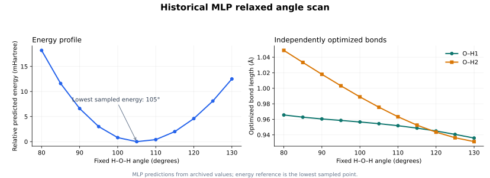

# 水分子能量表示与 CMA-ES 优化实验

本说明独立记录实验问题、方法、设置、结果和结论。历史 MLP 实验与当前
PySCF 运行分别列出：前者学习近似能量函数，后者在每次优化评估时直接
进行电子结构计算。文中的历史结果是已有实验记录，本次整理没有重新
训练这些模型。

## 1. 要解决的问题

给定分子几何结构，电子结构计算可以得到单点能；结构优化则反复改变
几何结构，寻找更低能量的位置。这里以单个水分子作为小型验证体系，
探索两个问题：

- 能否用简单的 MLP 近似 DFT 能量，并对预测能量进行结构优化？
- 输入使用原子坐标，还是具有直接化学意义的键长和键角，会带来怎样
  的结果差异？

两类实验都采用 CMA-ES 作为优化器。它根据能量评价候选结构、更新采样
分布，不需要目标函数提供解析梯度。当前项目进一步采用 PySCF 直接
计算能量，保留相同的优化思路。

## 2. 历史参考数据的构建

参考数据集包含 1,500 个水分子构型及对应的 B3LYP/6-31G* 单点能。
最初在较大坐标范围中随机生成三个原子的位置，但过近的原子或不合理
构型容易造成 SCF 不收敛。最终使用的采样设置为：

| 项目 | 设置 |
| --- | --- |
| 氧原子 | 固定为 `(0, 0, 0)` |
| 两个氢的坐标分量 | 位于 `(-2, 2)` Å |
| 氢原子的 x 分量 | 第一个非负，第二个非正 |
| 电荷 / 自旋多重度 | 0 / 1 |
| 参考计算 | B3LYP/6-31G* |
| 历史计算附加设置 | `nosymm`、`SCF=conver=6` |
| SCF 失败构型 | 删除并重新生成，直到得到 1,500 个有效点 |
| 输出目标 | 单点能，单位 Hartree |

这是一种探索性采样方式，不保证对平衡结构附近或整个势能面的均匀覆盖。
剔除失败构型也会改变数据分布。仓库没有收录这批原始训练数据，因此
这里给出的是实验设置和已记录结果，而不是完整的训练复现包。

## 3. 笛卡尔坐标与内坐标

固定氧原子后，笛卡尔输入为两个氢的六个坐标：

```text
X_cartesian = [x_H1, y_H1, z_H1, x_H2, y_H2, z_H2]
```

分子整体旋转会改变这些分量，但不会改变孤立分子的能量。模型因而
需要从数据中学习这些等价结构的关系。

对水分子，可以改用三项内坐标：

```text
X_internal = [r_OH1, r_OH2, angle_HOH]
```

以从氧指向两个氢的向量 `u`、`v` 表示，转换为：

```text
r_OH1 = ||u||
r_OH2 = ||v||
angle_HOH = acos((u · v) / (||u|| ||v||)) × 180 / π
```

实现时需拒绝零长度键，并将反余弦输入截断到 `[-1, 1]`，避免浮点误差
使其超出定义域。内坐标有直接的几何意义，也消除了这里的整体平移和
旋转变量。

例如同一条历史样本可以表示为：

| 表示 | 输入 |
| --- | --- |
| 笛卡尔 | `[1.20981, 0.74987, 1.24863, -0.04313, 1.16152, 1.47391]` Å |
| 内坐标 | `[1.89342, 1.87707, 41.56487]`，键长 Å、键角 ° |
| 对应能量 | `-76.1141702491` Hartree |

## 4. MLP 能量拟合设置与结果

两组实验都使用 `StandardScaler` 缩放输入，并以随机种子 24 划分
1,125 个训练点与 375 个测试点。MLP 使用 `tanh` 激活、`lbfgs` 求解器、
`max_iter=10000` 和随机种子 45。

| 项目 | 笛卡尔坐标模型 | 内坐标模型 |
| --- | ---: | ---: |
| 输入维度 | 6 | 3 |
| 隐藏层 | `[25, 25]` | `[20, 20]` |
| 正则化 `alpha` | 0.01 | 0.0001 |
| 训练集 R² | 0.9372755336 | 0.9919439485 |
| 测试集 R² | 0.7523257261 | 0.9724540033 |

R² 是能量回归的评价指标，不是几何优化成功率。内坐标模型在这次实验
中的拟合与泛化表现更好，但网络结构和正则化也同时变化，无法仅凭
这两次结果隔离坐标表示的因果作用。

历史流程先对全体数据拟合缩放器，再划分训练集和测试集。这使缩放参数
包含测试集分布的信息。重新开展评估时应先划分数据，只在训练集拟合
缩放器，再将同一个变换应用于测试集；可通过 Pipeline 实现，见
[scikit-learn 数据泄漏说明](https://scikit-learn.org/stable/common_pitfalls.html#data-leakage)。
上表保留原流程的历史数值，没有将其标记为修正流程后的新结果。

## 5. 使用模型能量进行结构优化

笛卡尔模型的 CMA-ES 初始输入为
`[0.2, 0.4, 0.7, -0.4, -0.4, -0.5]` Å，初始步长 0.5，随机种子 74。
每次候选输入先经同一个缩放器处理，再送入 MLP 得到能量。

内坐标模型的两条键长分别独立优化。由于键长通常在 Å 的个位数范围，
键角则在度的百位数附近，优化器使用：

```text
q = [r_OH1, r_OH2, angle_HOH / 100]
energy(q) = MLP.predict([q[0], q[1], 100 × q[2]])
```

这里的 `MLP.predict` 包含训练时的输入缩放。初始向量为
`[1.0, 1.0, 1.2]`，对应 1 Å、1 Å、120°，初始步长为 0.2。
该历史内坐标优化没有记录固定的 CMA-ES 随机种子。

| 方法 | 第一条 O–H / Å | 第二条 O–H / Å | H–O–H / ° |
| --- | ---: | ---: | ---: |
| 笛卡尔 MLP + CMA-ES | 0.8779 | 1.0249 | 78.25 |
| 内坐标 MLP + CMA-ES | 0.9541 | 0.9738 | 105.70 |
| 独立 DFT 结构优化参考 | 0.9687 | 0.9687 | 103.65 |

笛卡尔模型的键角偏差明显；内坐标模型的两条键长和键角相对偏差约为
−1.5%、+0.5% 和 +2.0%。这个结果支持在本小体系上使用几何含义明确的
输入表示，但能量拟合良好仍不等于完整势能面或最低点预测必然可靠。

## 6. 柔性角度扫描

柔性扫描是在固定某个几何变量后，对其余变量继续优化。历史实验固定
H–O–H 键角为 80° 至 130°，每次增加 5°，独立优化两条 O–H 键长。
每个角度从 `[0.96, 0.96]` Å 开始，CMA-ES 初始步长 0.2、随机种子 74。
这些能量来自内坐标 MLP，而不是当前 PySCF Notebook。

| 键角 / ° | 第一条 O–H / Å | 第二条 O–H / Å | 预测能量 / Hartree |
| ---: | ---: | ---: | ---: |
| 80 | 0.9656 | 1.0488 | -76.3888 |
| 85 | 0.9628 | 1.0333 | -76.3954 |
| 90 | 0.9605 | 1.0180 | -76.4004 |
| 95 | 0.9586 | 1.0032 | -76.4040 |
| 100 | 0.9566 | 0.9889 | -76.4062 |
| 105 | 0.9544 | 0.9756 | -76.4070 |
| 110 | 0.9518 | 0.9633 | -76.4066 |
| 115 | 0.9487 | 0.9525 | -76.4050 |
| 120 | 0.9450 | 0.9435 | -76.4024 |
| 125 | 0.9406 | 0.9363 | -76.3989 |
| 130 | 0.9359 | 0.9313 | -76.3945 |

同一张表也提供为 [CSV](data/relaxed_scan.csv)。在这组离散角度中，
105° 的预测能量最低；这与内坐标模型优化得到的约 105.70° 一致。
粗网格扫描只能定位最低点附近，不能代替连续优化。



图中相对能量以这组采样点的最低预测值为零点，单位为 mHartree。
曲线由上表已归档、保留四位小数的数值生成，不含新的 PySCF 计算结果。

历史独立 DFT 扫描的对比观察为：能量曲线的整体走势和最低点位置接近，
低键角区域存在近似恒定的能量偏移，高键角区域的定量偏差更明显。
当偏移在比较区域近似恒定时，相对能量曲线仍可较为接近；这不意味着
所有绝对能量偏差或随结构变化的误差都可以忽略。该 DFT 扫描的逐点
数值未归档在仓库中，此处不绘制缺少数据的参考曲线。

两个氢等价，但历史模型没有强制交换两条 O–H 键后能量保持一致。
扫描中两条键长有不同变化幅度，说明回归与优化结果也需要从物理
对称性的角度检查，不能只看能量回归分数。

## 7. 当前主要版本：PySCF 直接能量优化

当前可运行示例位于
[`notebooks/water_optimization_pyscf.ipynb`](../notebooks/water_optimization_pyscf.ipynb)。
它每次计算 PySCF 单点能，不使用上述 MLP。两条键约束为等长，因此
优化器输入为 `[r, angle / 100]`，实际结构为：

```text
O
H 1 r
H 1 r 2 angle
```

| 设置 | 默认值 |
| --- | --- |
| 方法 / 基组 | B3LYP / 6-31G* |
| 电荷 / 自旋多重度 | 0 / 1 |
| SCF 能量收敛容差 / 最大循环数 | `1e-8` / 128 |
| 原子积分网格点数 | `(75, 302)` |
| 初始结构 | 1.0 Å、100° |
| CMA-ES 初始步长 / 随机种子 | 0.25 / 2445 |
| 搜索范围 | 0.5–2.0 Å、30–170° |
| 最大迭代数 | 80 |
| 能量停止容差 | `tolfun=1e-8` |

一次已验证的运行得到等长键长 0.96866169 Å、键角 103.86624878°、能量
−76.407023582773 Hartree，306 次优化评估后按能量容差停止。环境与
验证范围见 [验证记录](validation.md)。此二变量约束优化与历史 MLP
实验的三变量优化不同，结果不能作为对两种能量来源的严格对照。

## 8. 结论与限制

1. **输入表示值得优先考虑。** 对这个小体系，键长和键角直接表示
   与能量有关的内部几何结构，消除了整体位姿带来的冗余。
2. **尺度应与优化方式匹配。** 让键长与缩放后的键角处于接近的数值
   范围，便于设置统一的 CMA-ES 初始步长。
3. **能量回归与结构优化要分别验证。** 测试集 R²、最低点几何结构、
   扫描曲线及对称性检查提供不同的信息。
4. **历史结果显示可行性，结论限于本实验。** 内坐标 MLP 在已记录
   实验中获得更接近参考的结构，当前 PySCF 示例也能完成能量驱动的
   结构搜索；这没有建立对大分子、其他基组或其他能量面的性能保证。
5. **扩大体系需要重新设计坐标和验证。** 更大分子的内坐标选择、
   变量耦合、构象覆盖和能量模型可靠性可能更复杂，不能直接套用
   水分子的两变量设置。

早期 Gaussian 实现及其历史结果保留在
[legacy/gaussian/](../legacy/gaussian/README.md)。不同程序的泛函实现、
积分方案与收敛设置可能影响数值，不能仅凭相同的方法标签认定计算等价。
